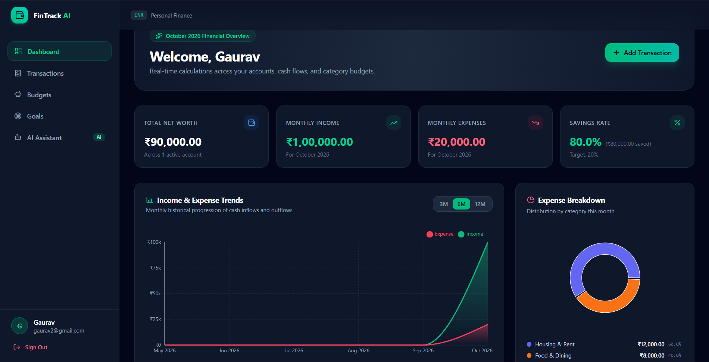
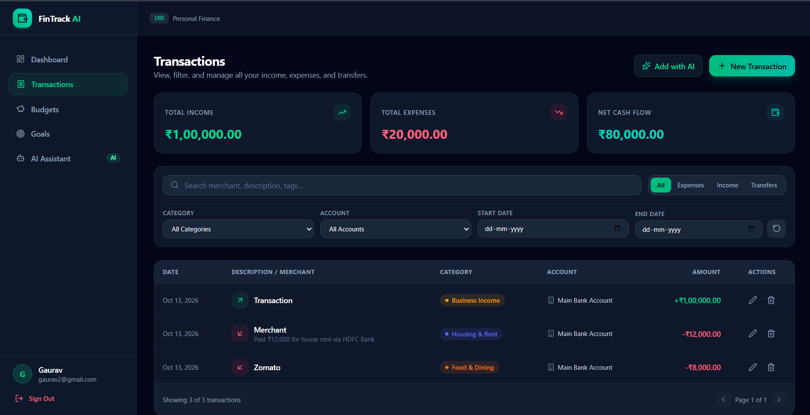
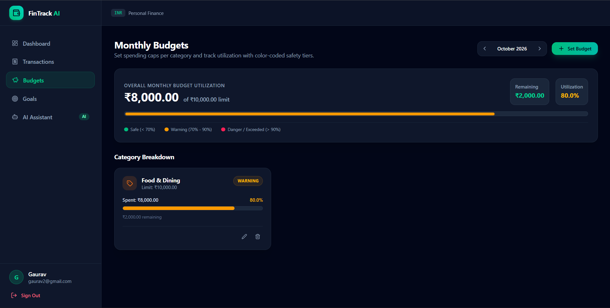
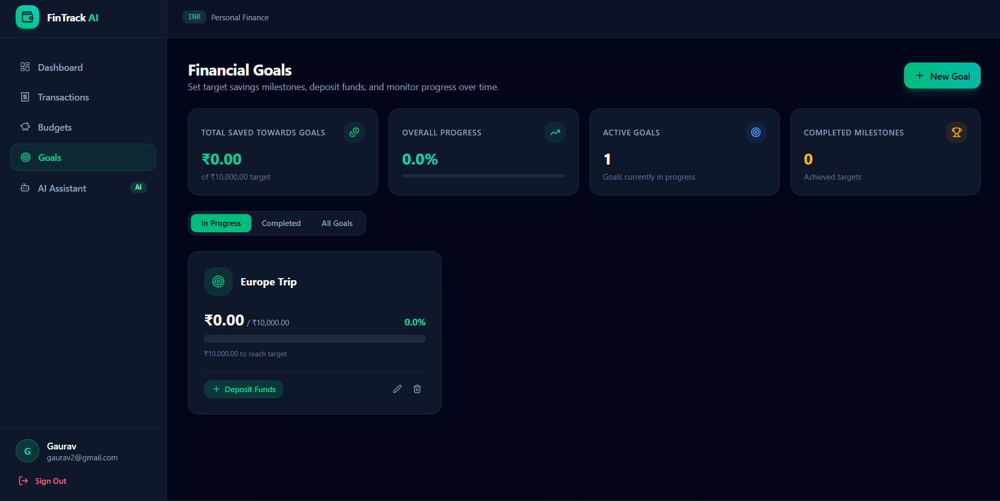
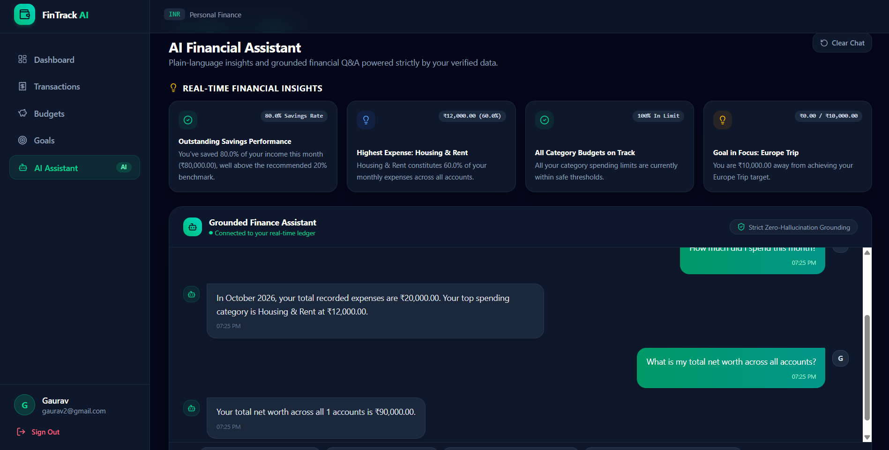

# FintrackAI — Smart Personal Finance Management

**Take control of your finances with intelligent insights.**

FintrackAI is a full-stack personal finance management application designed to help users organize transactions, manage budgets, track financial goals, and explore AI-powered financial assistance through a modern web interface.

## Overview

FintrackAI combines a React frontend with a Django REST Framework backend to provide a structured foundation for personal finance tracking and financial insights.

## Features

- **User Authentication** — Registration, login, JWT-based authentication, and protected routes.
- **Transaction Management** — Organize and track financial transactions.
- **Budget Management** — Create and manage personal budgets.
- **Financial Goals** — Set and track financial goals.
- **Analytics Dashboard** — View financial summaries and analytics.
- **AI Assistant** — Access AI-powered financial assistance.
- **Category Management** — Organize financial activity by category.
- **Responsive Interface** — Navigate the application through a modern React-based UI.

*Feature availability and implementation details should be verified against the current application.*

## Tech Stack

| Layer | Technologies |
|---|---|
| Frontend | React, JavaScript, Vite, CSS |
| Backend | Python, Django, Django REST Framework |
| Authentication | JWT, Simple JWT |
| Database | PostgreSQL / SQLite configuration |
| API Integration | REST APIs |
| AI Integration | Configurable AI provider |
| Development Tools | Git, GitHub, VS Code |

## Project Structure

```text
FintrackAI/
├── backend/
│   ├── apps/
│   │   ├── accounts/
│   │   ├── ai/
│   │   ├── analytics/
│   │   ├── budgets/
│   │   ├── categories/
│   │   ├── goals/
│   │   ├── transactions/
│   │   └── users/
│   ├── fintrack_core/
│   ├── tests/
│   ├── manage.py
│   └── requirements.txt
├── frontend/
│   ├── public/
│   ├── src/
│   │   ├── api/
│   │   ├── components/
│   │   ├── context/
│   │   └── pages/
│   └── package.json
├── .env.example
├── .gitignore
└── README.md
```

## Getting Started

### Prerequisites

- Python compatible with the backend dependencies
- Node.js and npm
- Git
- Database configuration required by the backend

### 1. Clone the repository

```bash
git clone https://github.com/YOUR-USERNAME/FintrackAI.git
cd FintrackAI
```

Replace `YOUR-USERNAME` with your GitHub username.

### 2. Configure the backend

```powershell
cd backend
python -m venv venv
.\venv\Scripts\Activate.ps1
pip install -r requirements.txt
```

Configure the required environment variables and database settings using `.env.example` as a reference. Never commit real credentials or API keys.

Apply database migrations and start Django:

```powershell
python manage.py migrate
python manage.py runserver
```

Backend development server: `http://127.0.0.1:8000/`

### 3. Configure the frontend

Open a second terminal from the project root:

```powershell
cd frontend
npm install
npm run dev
```

Open the local URL printed by Vite, usually `http://localhost:5173/`.

Ensure the frontend API configuration points to the running backend.

## Application Screenshots

### Dashboard


### Transactions


### Budgets


### Financial Goals


### AI Assistant


## Environment Configuration

Use `.env.example` to identify the configuration variables required by the application. Set your own development values and configure database and AI credentials where needed.

Never publish API keys, passwords, or production secrets.

## Testing

Backend tests are located in `backend/tests/` and individual application test modules.

Run the backend test suite from the `backend` directory:

```powershell
python manage.py test
```

Verify the test suite and database configuration before relying on the results.

## Roadmap

- [ ] Add application screenshots and a demo
- [ ] Document API endpoints
- [ ] Expand automated test coverage
- [ ] Improve deployment and production configuration
- [ ] Add a live demo when deployment is available

## Contributing

Suggestions and bug reports are welcome. Open an issue to discuss a proposed improvement before submitting substantial changes.

## Security

Do not include credentials, private financial information, or production secrets in issues, screenshots, commits, or configuration examples.

## License

A license has not yet been specified. Add an appropriate open-source license before granting others permission to reuse or redistribute the code.


---

**FintrackAI** — Personal finance management with a smarter approach.